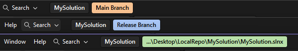

# Solution Alias

**[Install from the Visual Studio Marketplace](https://marketplace.visualstudio.com/items?itemName=WilloAndCo.SolutionAlias)**

A Visual Studio 2022 and 2026 extension that adds a coloured label next to the solution name in the title bar to customise solution appearance.

## What it does

The label is a WPF adorner attached to Visual Studio's solution name element in the title bar.

It displays either the solution path, or a custom alias chosen for the solution, and custom colouring. A colour is generated from the path if one is not chosen.

This data is stored alongside the solution.

## Building

Install Visual Studio with "Visual Studio extension development" enabled.

Open and build `SolutionAlias.sln`, F5 starts the experimental instance with the extension.

## Projects

| Project | Purpose |
| --- | --- |
| `SolutionAlias` | The extension logic. |
| `Tests\SolutionAlias.UnitTests` | Unit tests. |
| `Tests\SolutionAlias.IntegrationTests` | Integration and UI tests run and test an instance of Visual Studio. |
| `Tests\SolutionAlias.VisualStudioInspector` | A custom extension the integration tests need to query Visual Studio's UI. |
| `Tests\SampleSolutions` | Generated solutions for integration tests to run against. |

## Unit tests

xUnit tests for cases that can be tested in isolation.

## Integration and UI tests

Every test runs twice, an instance of Visual Studio 2022 and 2026.

- **Integration** - Check behaviour by changing state directly, without mouse input.
- **UI** - Check behaviour with controlled mouse input.

### Visual Studio Inspector

Visual Studio's automation API (DTE) is not able to query Visual Studio's WPF interface. Solution Alias uses WPF to draw the label.

The Visual Studio Inspector adds the functionality needed to test the label. It is a small extension that registers itself as a DTE automation object, and the tests access it through DTE. An extension can access WPF because it runs inside Visual Studio.

The Inspector is installed when the test sets up an instance of Visual Studio to run.

### Running order

1. **Prepare Visual Studio** - create or reset a separate settings folder to run with, build the Solution Alias and Inspector extensions, copy the extensions to the settings folder.
2. **Copy a sample solution** - create a temporary copy of a test solution, deleted when the test ends.
3. **Start Visual Studio** - using the settings folder, open the solution copy.
4. **Connect** - find Visual Studio's DTE object in Windows' Running Object Table, wait for the solution to open, load the extension and reset it to default.
5. **Run the test**
6. **Clean up** - close Visual Studio, delete the copy, and fail the test if the ActivityLog has errors that mention the extension. Each run's log is stored in a results folder.

### Controlling Visual Studio

| Control | Used for |
| --- | --- |
| DTE over COM | Opening and closing solutions and reading Visual Studio's state. If Visual Studio is busy retry calls rather than failing. |
| The inspector extension, DTE | Reading the label and setting options. |
| Windows UI Automation | Finding dialogs, buttons and menus. |
| Windows `SendInput` | Real mouse clicks and drags. |

### Additional info

Both Visual Studio 2022 and 2026 must be installed.

Leave tests to run, they open instances and move the mouse, interruption can fail the tests.

## Licence

[MIT](LICENSE.txt)
